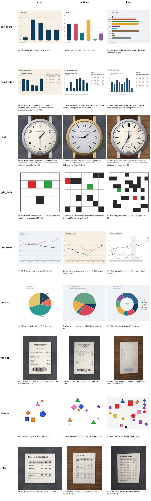
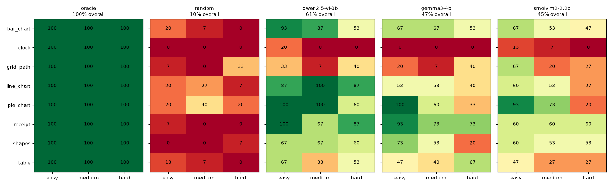
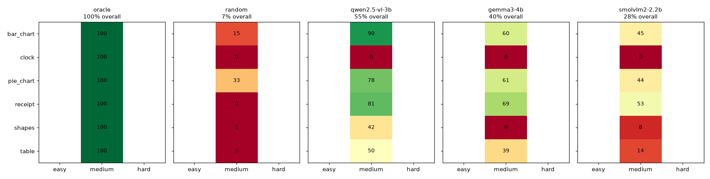

# Visual Task Factory

Make synthetic pictures with questions whose answers are known by construction, check that each picture really shows what its answer claims, then grade any vision model and see where it breaks.



## What it does

1. **Generate.** A seed picks a spec (bar values, clock time, shape positions, receipt lines...). The image is drawn from the spec and the answer is computed from the spec. No model ever writes an answer.
2. **Verify.** Each item passes three checks before it enters the dataset:
   - a separate verifier module recomputes the answer from the spec with different code;
   - pixel probes read the saved PNG and confirm it matches the spec (bar lengths in pixels, hand angles, cell colours, visible area of each shape, text inside its cell);
   - ambiguity guards drop items a careful person could get wrong for honest reasons (near-tied bars under 3 px apart, overlapping clock hands, hidden shapes, tied maxima). Rejected candidates are counted in `generation.json`.
3. **Run.** Ask any OpenAI-compatible vision endpoint (llama.cpp, vLLM, Ollama, a hosted API). Runs resume after a crash.
4. **Grade.** Typed checkers: exact label (must name exactly one valid option), numeric with tolerance, clock time (12-hour wrap), ordering, yes/no. Each miss is tagged correct / near miss / wrong / unparseable.
5. **Report.** Accuracy by family, difficulty, question type and difficulty knob, a heatmap, and a gallery of failures.

## Task families

| family | questions | difficulty knobs |
|---|---|---|
| bar_chart | tallest, shortest, value of a bar, count above a threshold, difference, top-3 order | bar count, near-ties, horizontal bars, rotated labels, value labels on/off, gridlines, colour shades |
| line_chart | highest series in a month, value at a point, peak month, crossings | series count, points, markers, gridlines, legend outside, line styles |
| pie_chart | largest, smallest, share of a slice | slices, percentages shown / names only / legend only, similar shades, start angle |
| shapes | count by colour, by kind, by both; colour of the largest; leftmost kind; total | object count, colours, overlap, noisy background |
| clock | read the time; minutes to the next hour | watch dials: numerals all / quarters / Roman / none, minute ticks, second hand, subdial, date window, bevel and shadow, similar hand lengths |
| table | cell lookup, column sum, row with the max, count above a threshold | rows, columns, font size, zebra stripes, rules on/off, photographed sheet (paper, skew, lighting) |
| receipt | final total, units bought, line total, priciest item | photographed thermal receipt: store header, barcode, five currencies (decimal comma for euro), items, discount, skew, perspective, uneven light, faded ink, dot dropout |
| grid_path | shortest path length, reachable or not, wall count | grid size, wall density, grid lines |
| chart_table | product with most or fewest units, units of a product, price of the top seller, revenue leader, units in a category (needs the chart and the table together) | products, value labels on/off, gridlines, theme, palette, font size, currency |

## Setup

Needs Python 3.12 and [uv](https://docs.astral.sh/uv/).

```bash
uv sync
scripts/demo.sh                     # 81 items, validation, oracle and random baselines, report
scripts/determinism.sh runs/det 7 10   # generate twice, validate both, compare every PNG and JSON byte for byte
```

With a local model (free, CPU is enough):

```bash
scripts/fetch_models.sh             # llama.cpp CPU build + three small vision models (about 8 GB)
scripts/serve.sh qwen2.5-vl-3b 8090 &
scripts/demo.sh http://127.0.0.1:8090 qwen2.5-vl-3b
```

## Docker

The image pins its base images by digest and installs from the lock file.

```bash
docker build -t vtf .
docker run --rm vtf                                    # test suite
docker run --rm -v "$PWD/out:/data" vtf uv run --frozen vtf generate /data/ds --seed 7
docker run --rm -v "$PWD/out:/data" vtf uv run --frozen vtf validate /data/ds --seed 7
docker run --rm -v "$PWD/out:/data" vtf scripts/determinism.sh /data/det 7 10
```

## Commands

```bash
uv run vtf generate runs/main --per-cell 15 --seed 7      # 9 families x 3 difficulties x 15 = 405 items
uv run vtf validate runs/main --seed 7                    # regenerate + re-derive + re-probe + grader self-test
uv run vtf run runs/main oracle                           # must score 100%
uv run vtf run runs/main random                           # lower bound
uv run vtf run runs/main openai:http://127.0.0.1:8090:qwen2.5-vl-3b
uv run vtf report runs/main oracle random qwen2.5-vl-3b   # runs/main/report/REPORT.md and index.html
uv run vtf samples runs/main docs/img/samples.png
uv run pytest -q
```

Set `VTF_API_KEY` to send a bearer token to a hosted endpoint.

## Adding a task family

Write four functions and register them (see `src/vtf/families/scenes.py`):

- `build(rng, difficulty) -> (spec, knobs)`
- `render(spec, knobs, path) -> render_info` (pixel geometry for probes)
- `probe(spec, render_info, image) -> [failures]`
- `ask(spec, render_info, rng, difficulty) -> Question` (raise `Reject` when the item would be ambiguous)

Then add the matching rule to `src/vtf/verify.py`. `vtf validate` and the tests pick the family up on their own.

## Results and write-up

These numbers were measured on the first version of the renderers, before the realism upgrade and before chart_table existed.

Main set (360 items, every validation check 360/360): Qwen2.5-VL-3B 61% (71%/57%/55% easy to hard), Gemma 3 4B 47% (57%/44%/41%), SmolVLM2 2.2B 45% (58%/43%/32%). Oracle 100%, random 10%.

Sweep set (184 items, every check 184/184): 55%, 40% and 28%. Oracle 100%, random 7%. All three models score 0% on table/col_sum (0/18) and 0% on clock/time (0/42) in the sweep.

The technical write-up is in [docs/WRITEUP.md](docs/WRITEUP.md). Full tables are in [docs/RESULTS.md](docs/RESULTS.md). Sample images, model replies, validation evidence and HTML reports are in [samples/](samples/).




