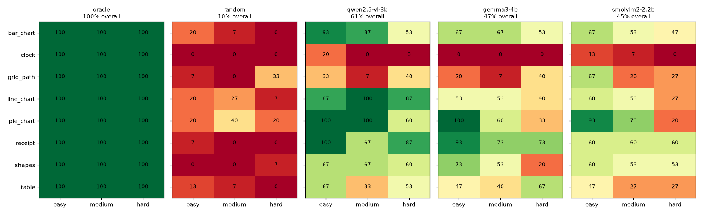
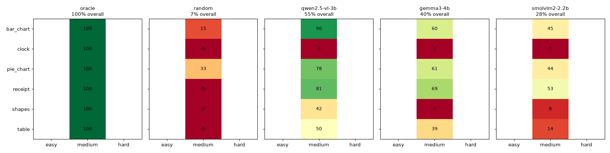

# Visual Task Factory: technical write-up

## Problem

Vision-language models read charts, clocks, tables and receipts, but it is hard to say how well, and where they fail. Hand-labelled test sets are slow to build, leak into training data, and their labels can be wrong. We want an unlimited supply of fresh visual questions whose answers are certain, and a test bench that shows which visual factors break a model.

## Approach

**The answer comes from the spec, never from a model.** A seed picks a spec: the values behind a bar chart, the time on a clock, where each shape sits, the lines on a receipt. The image is drawn from the spec and the answer is computed from the same spec. Seeds are hashed per item, so any item can be rebuilt alone, and the same seed gives byte-identical PNGs.

**Eight task families, three difficulty levels, many knobs.** Bar, line and pie charts; counting shapes; analog clocks; data tables; shop receipts; grid mazes. Each family has its own question types (lookup, compare, count, rank, arithmetic, path finding) and its own difficulty knobs: near-tied values, rotated or missing labels, legends instead of labels, similar colour shades, Roman or missing numerals, second hands, small fonts, skew, blur, faded ink, overlap, noisy backgrounds, bigger grids. Each item stores its knob settings, so results can be cut by any knob.

**Answers are shown to be right, not claimed to be right.** Each item must pass three independent checks:

1. *Re-derivation.* A separate verifier module, written with different code (plain loops, a Bellman-Ford relaxation instead of the generator's breadth-first search, decimal rounding instead of integer arithmetic), recomputes every answer from the spec. Any disagreement stops generation.
2. *Render probes.* Pixel checks on the saved PNG confirm the image shows what the spec says: each bar is measured in pixels and must match its value within 3 px; clock hands must sit at the right angles; every grid cell has the right colour; each shape keeps at least 60% of its area visible and shows its colour; table text fits its cell; receipt lines stay on the paper. No OCR and no model is involved.
3. *Ambiguity guards.* Items that a careful person could get wrong for honest reasons are dropped and redrawn: top bars less than 3 px apart, slices within 3 points, overlapping clock hands, a largest shape that is partly hidden, tied maxima, thresholds sitting on a data value.

`vtf validate` repeats all of this from scratch for a finished dataset: it regenerates every item from its seed, compares spec, question and image bytes, re-runs the verifier and the probes, and tests the grader by feeding it the true answer (must pass) and a corrupted one (must fail).

**Grading free text fairly.** Small models answer in loose prose. Typed checkers turn a reply into a value: labels must name exactly one valid option (so "Pears or Plums" fails), numbers allow a stated tolerance only where reading off an unlabelled axis needs one, clock times wrap at 12 hours, orderings must match in sequence. Every miss is tagged as near miss, wrong or unparseable, which separates reading errors from format errors. An oracle baseline must score 100% and a random baseline gives the floor.

**Controlled sweeps.** The main set varies many factors at once. A sweep holds the content and question fixed and changes one knob at a time (gridlines on or off, numerals style, blur, font size and so on). If a model's answer flips, that knob alone caused it.

**Model-agnostic runs.** Any OpenAI-compatible vision endpoint plugs in. We used only free, local compute: llama.cpp on a 16-core CPU with three small open models (Qwen2.5-VL 3B, Gemma 3 4B, SmolVLM2 2.2B, 4-bit). Runs resume after a crash.

## Results

Two sets were built and checked, then answered by an oracle, a random guesser and three small open models.

- **Main set:** 360 items, 8 families x 3 difficulties. Validation: answer re-derivation 360/360 agree, render probes 360/360 pass, byte-identical regeneration 360/360.
- **Sweep set:** 184 items over 6 families, one knob changed at a time. Validation: re-derivation 184/184, probes 184/184, regeneration 184/184.

**Main set accuracy**

| model | overall | easy | medium | hard | unparseable | median latency |
|---|---|---|---|---|---|---|
| oracle | 100% | 100% | 100% | 100% | 0 | 0.0s |
| random | 10% | 11% | 10% | 8% | 0 | 0.0s |
| qwen2.5-vl-3b | 61% | 71% | 57% | 55% | 0 | 8.97s |
| gemma3-4b | 47% | 57% | 44% | 41% | 1 | 18.49s |
| smolvlm2-2.2b | 45% | 58% | 43% | 32% | 2 | 6.14s |

The oracle scores 100% and random sits at 10%, so the grader and the items behave. Accuracy falls from easy to hard for every model, so the difficulty levels do what they claim.

**By family (main set)**

| family | qwen2.5-vl-3b | gemma3-4b | smolvlm2-2.2b |
|---|---|---|---|
| bar_chart | 78% | 62% | 56% |
| clock | 7% | 0% | 7% |
| grid_path | 27% | 22% | 38% |
| line_chart | 91% | 49% | 47% |
| pie_chart | 87% | 64% | 62% |
| receipt | 84% | 80% | 60% |
| shapes | 64% | 49% | 56% |
| table | 51% | 51% | 33% |

What we learned:

- **Analog clocks defeat all three models.** On the clock/time question, accuracy is 3%, 0% and 8% (36 items). Across the whole clock family (including minutes to the next hour) it is 7%, 0% and 7%. Replies are well formed times that are simply wrong (for example "12:00" for 5:05), so this is a reading failure, not a format failure. In the sweep, clock/time scores 0% on all 42 items for every model under every setting, so no single clock knob is to blame.
- **Reading is easy, arithmetic over the image is not.** On tables, lookup scores 100%, 100% and 77%, but column sums (table/col_sum) score 20%, 0% and 0% on the main set (10 items). On the sweep, all three models score 0% on table/col_sum (0/18). On receipts, the printed total scores 100% for all three, while counting units scores 56%, 44% and 0%.
- **Maze path length is near the floor.** grid_path/path_len scores 12%, 12% and 17%, while "is it reachable" scores 88%, 62% and 88%.
- **Legends and similar shades hurt.** For pie charts, smolvlm2-2.2b drops from 93% with percent labels to 20% with a legend, and from 77% with distinct colours to 10% with shades. gemma3-4b drops from 100% to 33% on the same label change.
- **Layout details move small models.** qwen2.5-vl-3b reads bar labels at 86% when flat but 40% at 60 degrees and 43% at 90 degrees. gemma3-4b on shapes falls from 63% to 20% when shapes overlap and from 73% to 20% as colours go from 3 to 8.

**Controlled sweeps (one knob changed, content fixed)**

| model | overall on sweep set |
|---|---|
| oracle | 100% |
| random | 7% |
| qwen2.5-vl-3b | 55% |
| gemma3-4b | 40% |
| smolvlm2-2.2b | 28% |

A flip is a group where changing only one knob turned a right answer wrong or the reverse. The clearest single-knob effects:

- smolvlm2-2.2b, pie labels: legend 0%, name 50%, percent 83%; 5/6 groups flip.
- gemma3-4b, receipt skew: -3 degrees 67%, flat 83%, +3 degrees 33%; 5/6 groups flip.
- gemma3-4b, bar label rotation: 4/6 groups flip.
- qwen2.5-vl-3b, bar value labels: without 100%, with 67%; 2/6 groups flip. Printing the numbers on the bars did not help this model.
- Table font size, rules and zebra striping cause no flips for qwen2.5-vl-3b (0/6 each), so its table errors come from the task, not the styling.

Full per-question and per-knob tables are in the results document and the HTML reports shipped with the sample outputs.

## Limits and next steps

- Small CPU models only; the bench runs any hosted model unchanged by pointing at its endpoint.
- Items are synthetic and clean by design; real-photo noise is only partly covered by the skew, blur and faded ink knobs.
- Tolerances for estimated values (unlabelled axes) are set by hand per question type.
- Next: more families (maps, flowcharts, floor plans), multi-image questions, and per-model difficulty calibration so each set sits near a target accuracy.
